# RENTSPHERE

## Smart Property and Rental Management System

### Final Project Report

**Technology stack:** React 19, TypeScript, Material UI, Spring Boot 3.5, Java 21, Spring Security, Spring Data JPA, PostgreSQL/Supabase, Razorpay and Server-Sent Events  
**Project type:** Full-stack web application  
**Academic year:** 2026

> Replace this block with the student name, registration number, department, institution, guide and university details before submission.

---

## Declaration

This report describes the design and implementation of RentSphere, a smart property and rental management system. The implementation, diagrams and test results documented here correspond to the source code maintained in the RentSphere repository. External libraries and services are acknowledged in the references.

## Acknowledgement

The project team expresses sincere gratitude to the project guide, faculty members, institution, peers and family members who supported the analysis, implementation and evaluation of RentSphere. The team also acknowledges the maintainers of the open-source frameworks and documentation used during development.

## Table of Contents

1. Abstract  
2. Problem Definition  
   2.1 Objective  
   2.2 Advantages of the Proposed System  
   2.3 Limitations: Scope and Boundary  
3. Requirement Analysis  
   3.1 Data Flow Diagram  
   3.2 ER Diagram  
   3.3 Requirement Specification  
   3.4 Hardware and Software Requirements  
4. System Design  
   4.1 Architectural Design  
   4.2 UML Diagrams  
   4.2.1 Class Diagram  
   4.2.2 Sequence Diagrams  
   4.2.3 Use Case Diagram  
   4.3 Database Design  
   4.4 Input Design  
   4.5 Output Design  
5. Implementation  
   5.1 Main Modules  
   5.2 Screenshots  
6. Testing  
   6.1 Test Case 1: Form Validation  
   6.2 Test Case 2: Authentication and Authorization  
   6.3 Test Case 3: Payment Processing  
   6.4 Test Case 4: Tenant Data Isolation  
   6.5 Test Case 5: Approval Workflow  
7. Appendices  
8. References

---

# 1. ABSTRACT

RentSphere is a role-based web application designed to centralize property administration and tenant self-service. Conventional rental management often depends on spreadsheets, messaging applications, paper agreements and disconnected payment records. This fragmentation makes it difficult to determine which unit is occupied, which invoice is outstanding, whether a maintenance request has been resolved, or who approved a rental decision. RentSphere addresses these problems through one secured platform for administrators, owners and tenants.

The system provides organization, user, property, building, unit, tenant, agreement, invoice, payment, complaint, deposit-dispute, rent-increase, booking, approval, notification and profile workflows. Administrators and owners manage portfolio records. Tenants browse apartments, request visits, review approval status, pay invoices, submit complaints, raise deposit disputes and respond to rent-increase notices. Razorpay test-mode integration provides hosted payment checkout and cryptographic verification. Real-time notifications use Server-Sent Events with a polling fallback. A contextual AI assistant can answer user questions using the records visible to the authenticated user.

The client is implemented using React, TypeScript, Vite and Material UI. The API uses Java 21, Spring Boot, Spring Security, Spring Data JPA and PostgreSQL. JSON Web Tokens identify the current user, while method-level authorization and tenant-owned `/me` endpoints protect personal data. Audit fields and soft deletion preserve record history. Automated integration tests cover module access, payment verification, invalid signatures, tenant isolation and application startup. The resulting system demonstrates a modular, secure and extensible approach to rental portfolio management.

**Keywords:** rental management, property management, tenant portal, Spring Boot, React, PostgreSQL, Supabase, Razorpay, JWT, role-based access control.

---

# 2. PROBLEM DEFINITION

Rental operations involve many connected records: organizations own portfolios; properties contain buildings; buildings contain units; tenants occupy units through agreements; agreements generate invoices; invoices produce payment attempts; and disputes or maintenance requests refer back to tenants and units. When these records are maintained separately, users experience duplicated data, inconsistent status values and slow communication.

The core problem is the absence of a unified and secure information flow between property managers and tenants. Owners require portfolio-wide visibility and controlled administrative operations. Tenants require a simple interface limited to their own payments, complaints, disputes and notices. A shared application must therefore support both broad management access and strict personal-data isolation.

RentSphere solves this problem through a relational domain model, REST API, role-aware frontend and event-driven notifications. It replaces informal status tracking with explicit states such as `AVAILABLE`, `OCCUPIED`, `PENDING`, `PAID`, `OPEN`, `RESOLVED`, `APPROVED` and `REJECTED`.

## 2.1 Objective

The primary objective is to design and implement a secure, usable and maintainable rental-management platform. Specific objectives are:

1. Centralize properties, buildings, units, tenants and agreements.
2. Provide separate experiences for administrator, owner and tenant roles.
3. Ensure tenants can retrieve only records associated with their authenticated identity.
4. Support apartment browsing and visit-request approval workflows.
5. Generate and track invoices and verified online payments.
6. Prevent completed invoices from continuing to appear as unpaid.
7. Support maintenance complaints, deposit disputes and rent-increase responses.
8. Deliver persistent, near-real-time notifications.
9. Maintain audit information and use soft deletion for recoverable history.
10. Provide responsive presentation, theme selection, language selection and accessible navigation.
11. Validate critical workflows using automated tests.
12. Keep the architecture modular enough for future mobile clients and additional integrations.

## 2.2 Advantages of the Proposed System

- **Single source of truth:** Related rental data is maintained in a structured relational database.
- **Role-based experience:** Users see only relevant modules and actions.
- **Tenant privacy:** Personal records are obtained through authenticated ownership mappings rather than user-supplied tenant identifiers.
- **Reduced duplication:** Dedicated apartment browsing replaces raw property/unit screens for tenants; the payment page combines invoices and transaction history.
- **Verified payments:** Razorpay order creation and signature verification reduce false success records.
- **Correct payment history:** Superseded pending attempts are hidden once the same invoice has a successful payment.
- **Traceability:** Creation, update and deletion metadata supports operational audits.
- **Recoverability:** Soft deletion avoids immediate physical removal of important records.
- **Timely communication:** Notifications update through Server-Sent Events and remain stored for later viewing.
- **Maintainability:** Controllers, services, repositories, DTOs and entities have distinct responsibilities.
- **Responsive UI:** The navigation and record views support desktop and smaller screens.
- **Extensibility:** New modules can follow the existing configuration-driven frontend and layered backend pattern.

## 2.3 Limitations: Scope and Boundary

The present version is a project implementation, not a complete commercial property-management suite. Its boundaries are:

- Razorpay is configured for test-mode demonstration unless production credentials and webhooks are supplied.
- Uploaded images are represented by URLs or data previews; a production deployment should use Supabase Storage or another object-storage service with signed URLs.
- Language selection is implemented at application level, but complete translation coverage depends on the available translation dictionary.
- Email delivery depends on external SMTP configuration.
- Server-Sent Events provide server-to-client updates; collaborative editing and bidirectional live messaging would require WebSockets or another channel.
- Legal rules for deposits, notices and agreements vary by jurisdiction and remain the responsibility of the property operator.
- The application does not perform bank settlement, tax filing, accounting reconciliation or credit assessment.
- AI answers are supportive and must not be treated as legal, financial or emergency advice.
- Database schema updates should be managed through versioned migrations in production instead of relying only on Hibernate `ddl-auto=update`.
- Performance testing at very large portfolio scale is outside the current evaluation.

---

# 3. REQUIREMENT ANALYSIS

Requirement analysis identifies users, data, external services, functional behavior and quality constraints. RentSphere has three primary actors:

- **Administrator:** manages the complete platform and organization-level records; the only role that can create, modify or delete ADMIN accounts.
- **Owner:** performs operational management for properties, tenants, finance and workflows inside their own organization; cannot grant or take over the ADMIN role.
- **Tenant:** uses apartment discovery and personal self-service functions.

External actors are Razorpay, the configured email provider, the AI provider and the PostgreSQL/Supabase database.

## 3.1 Data Flow Diagram

### Level 0: Context Diagram

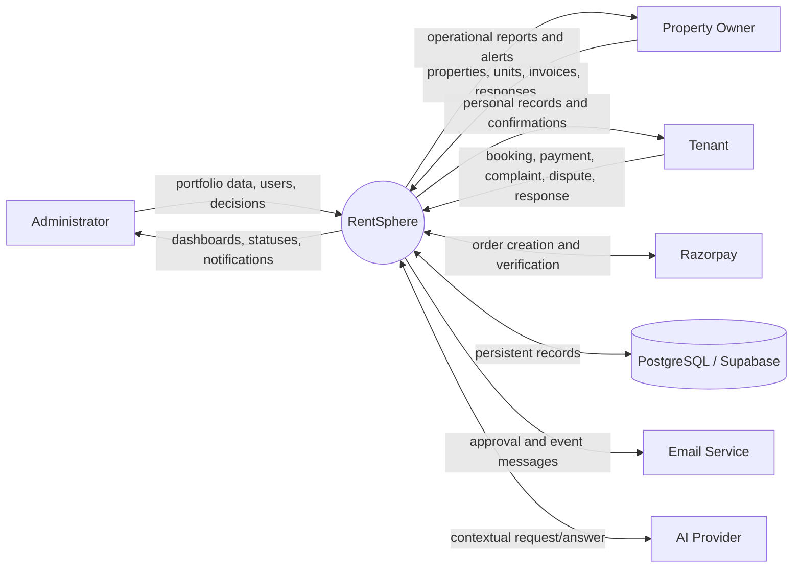

### Level 1: Major Processes

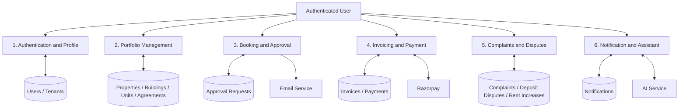

### Level 2: Payment Process

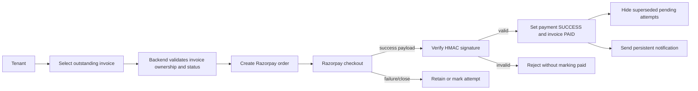

## 3.2 ER Diagram

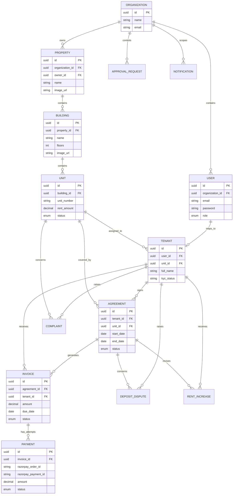

## 3.3 Requirement Specification

### Functional Requirements

| ID | Requirement | Priority |
|---|---|---|
| FR-01 | Register and authenticate users using email and password | High |
| FR-02 | Issue a signed JWT and secure protected routes | High |
| FR-03 | Allow users to view/update their profile and change password | High |
| FR-04 | Manage organizations and role-bearing users | High |
| FR-05 | Manage properties, buildings and units with images and availability | High |
| FR-06 | Manage tenant profiles, unit assignment and KYC references | High |
| FR-07 | Manage rental agreements, dates, rent and status | High |
| FR-08 | Create invoices and show tenant-owned outstanding invoices | High |
| FR-09 | Create and verify Razorpay payment orders | High |
| FR-10 | Mark an invoice paid only after successful verification | High |
| FR-11 | Prevent successful invoices from showing obsolete pending attempts | High |
| FR-12 | Allow tenants to browse apartments and request visits | High |
| FR-13 | Allow managers to approve or reject requests | High |
| FR-14 | Allow tenants to submit complaints and deposit disputes | High |
| FR-15 | Allow owners to issue rent increases and tenants to respond | High |
| FR-16 | Deliver and persist notifications with read status | Medium |
| FR-17 | Provide a role-aware dashboard and navigation | High |
| FR-18 | Provide theme and language selection | Medium |
| FR-19 | Provide contextual AI assistance within authorized scope | Medium |
| FR-20 | Support soft deletion and audit metadata | High |

### Non-Functional Requirements

| Category | Requirement |
|---|---|
| Security | Passwords must be BCrypt encoded; protected endpoints require valid authentication; method authorization enforces roles. |
| Privacy | Tenant-owned endpoints must derive tenant identity from the authenticated user. |
| Integrity | Payment success requires Razorpay signature verification; derived rent values are not redundantly persisted. |
| Usability | Interfaces use clear labels, status chips, validation feedback, empty states and responsive layouts. |
| Reliability | API errors use consistent responses; notifications persist even when live delivery is unavailable. |
| Maintainability | Layered backend and configuration-driven frontend reduce duplication. |
| Portability | Docker configuration and environment variables support local and deployed environments. |
| Performance | Repository filtering, pagination, caching and compact responses reduce avoidable work. |
| Accessibility | Semantic controls, keyboard-accessible menus, contrast-aware themes and responsive presentation are required. |

### Role Permission Matrix

| Capability | Admin | Owner | Tenant |
|---|:---:|:---:|:---:|
| Self-registration | First bootstrap user only | No (provisioned via /users) | Yes |
| Manage organizations/users | Yes (all roles) | Yes (own org, except ADMIN accounts) | No |
| Create/modify ADMIN accounts | Yes | No | No |
| Manage property inventory | All organizations | Own organization | Browse available |
| Manage tenants/agreements | Yes | Yes (own organization) | No |
| Manage invoices | Yes | Yes (own organization) | No |
| Pay own invoice | Yes | Yes | Yes |
| View personal payment history | N/A | N/A | Yes |
| Submit complaint | Yes | Yes | Yes |
| Update complaint status | Yes | Yes (own organization) | No |
| Submit deposit dispute | Yes | Yes | Yes |
| Decide approvals | Yes | Yes (own organization) | No |
| View own approval status | Yes | Yes | Yes |
| Issue rent increase | Yes | Yes (own organization) | No |
| Respond to own rent increase | No | No | Yes |
| Cross-organization record access | Allowed | Blocked (403) | N/A |

Organization isolation is enforced in the service layer: collection endpoints filter by the authenticated user's `organizationId`, single-record reads and mutations assert organization membership, and shared caches key entries by caller scope. Only administrators may create, update or delete ADMIN-role users, which removes every privilege-escalation path from the OWNER role.

## 3.4 Hardware and Software Requirements

### Development Hardware

- 64-bit computer with a modern dual-core or better processor.
- Minimum 8 GB RAM; 16 GB recommended.
- At least 5 GB free disk space for source, dependencies, database and generated assets.
- Reliable internet connection for Maven/npm dependencies and external test services.

### Client Hardware

- Desktop, laptop, tablet or modern smartphone.
- Display resolution of at least 360 pixels width.
- Internet connection and a current standards-compliant browser.

### Software

| Layer | Requirement |
|---|---|
| Operating system | Windows, Linux or macOS |
| Backend | Java 21, Maven, Spring Boot 3.5.16 |
| Frontend | Node.js, npm, React 19, TypeScript 6, Vite 8 |
| UI | Material UI, Emotion, OverlayScrollbars |
| Database | PostgreSQL/Supabase; H2 PostgreSQL mode for tests |
| Security | Spring Security, JWT, BCrypt |
| Payment | Razorpay test or live account |
| API documentation | Springdoc OpenAPI/Swagger UI |
| Deployment | Docker and Docker Compose (optional) |

---

# 4. SYSTEM DESIGN

## 4.1 Architectural Design

RentSphere follows a client-server and layered service architecture. The browser renders the React single-page application. Axios sends JSON requests to Spring Boot. The security filter validates the JWT and constructs the authenticated principal. Controllers enforce endpoint permissions and delegate business operations to services. Services apply rules and transaction boundaries. Repositories communicate with PostgreSQL using Spring Data JPA.

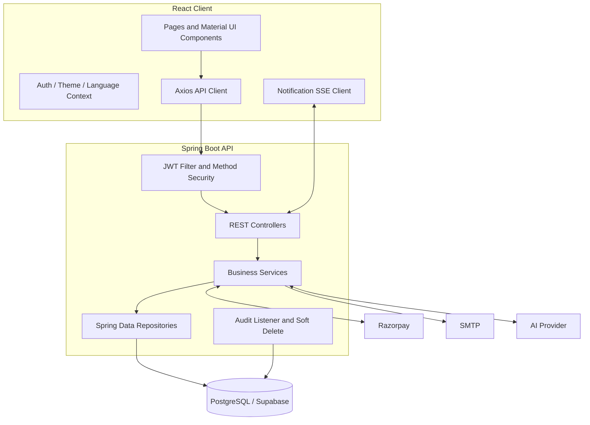

### Component Responsibilities

- **Pages/components:** presentation, user input, loading/error states and navigation.
- **Module configuration:** fields, columns and labels for reusable CRUD views.
- **Authentication context:** session lifecycle, decoded role and logout.
- **Controllers:** request validation, route mapping and role constraints.
- **DTO mapper:** separates external API structures from persistence entities.
- **Services:** ownership checks, payment lifecycle, approval state transitions and notifications.
- **Repositories:** persistence queries including organization and tenant filters.
- **Audit listener:** creation, update and deletion metadata.
- **Database:** durable relational state.

## 4.2 UML Diagrams

### 4.2.1 Class Diagram

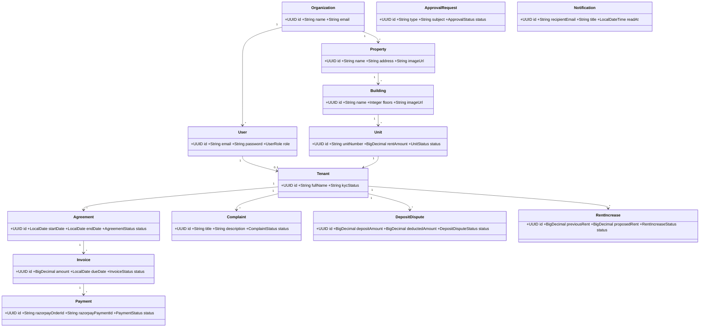

### Backend Layer Class Diagram

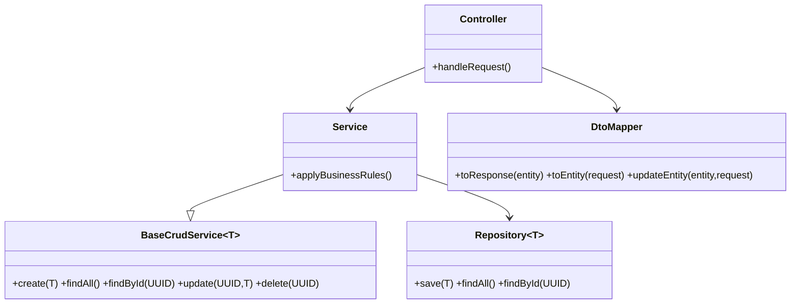

### 4.2.2 Sequence Diagrams

#### Login Sequence

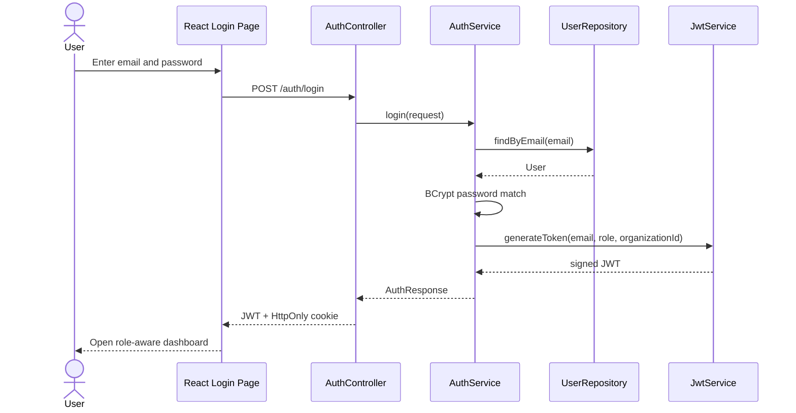

#### Apartment Booking and Approval Sequence

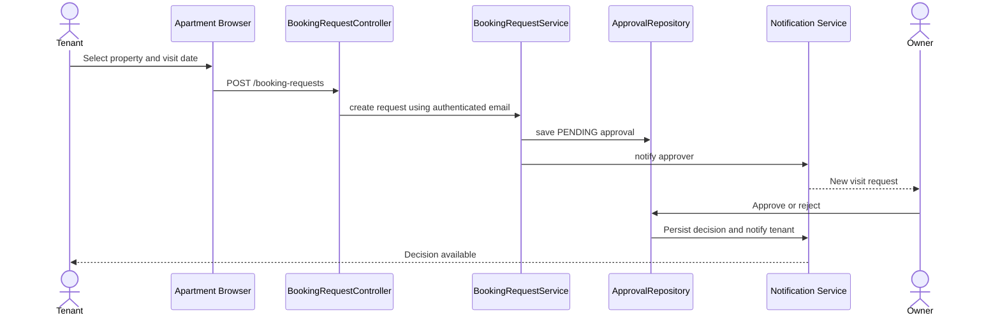

#### Verified Payment Sequence

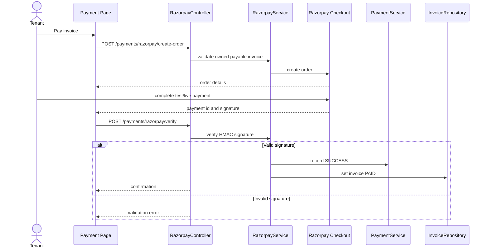

#### Real-Time Notification Sequence

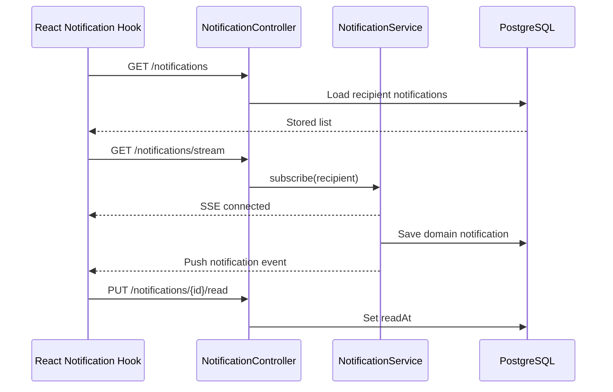

### 4.2.3 Use Case Diagram

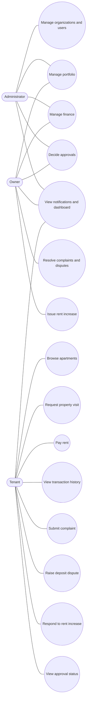

## 4.3 Database Design

The database uses UUID primary keys. Most business tables include `organization_id` for portfolio scoping. Soft-deletable entities include `deleted`, `deleted_at`, `deleted_by`, `created_at`, `updated_at`, `created_by` and `updated_by`. Hibernate restrictions exclude deleted records from ordinary queries.

| Table | Important fields | Purpose |
|---|---|---|
| organizations | id, name, address, phone, email | Rental operating group |
| users | organization_id, name, email, password, role | Authentication identity |
| properties | organization_id, owner_id, name, address, image_url | Property-level record |
| buildings | property_id, name, floors, image_url | Building within a property |
| units | building_id, unit_number, rent_amount, status, image_url | Rentable inventory |
| tenants | user_id, unit_id, contact and KYC fields | Tenant business profile |
| agreements | tenant_id, unit_id, dates, rent_amount, status | Lease relationship |
| invoices | tenant_id, agreement_id, amount, due_date, status | Amount due |
| payments | invoice_id, Razorpay identifiers, amount, status | Payment attempts and results |
| complaints | tenant_id, unit_id, title, description, status | Maintenance workflow |
| deposit_disputes | agreement and estimate fields, evidence, status | Deposit settlement workflow |
| rent_increases | previous/proposed rent, dates, responses, status | Rent revision workflow |
| approval_requests | type, subject, requester/approver, decision | General approval workflow |
| notifications | recipient, title, detail, target, read_at | Persistent user alerts |

### Normalization Decisions

The schema separates each major business concept to reduce repeated values. `Payment.amount` is retained even though an invoice has an amount because it records the amount associated with an individual payment attempt. `previous_rent` and `proposed_rent` are retained for rent-history meaning, while redundant `increase_amount` and `increase_percent` columns were removed because they can be derived and could become inconsistent. Organization and tenant identifiers are retained on transactional records to support secure scoping and efficient retrieval.

### Data Integrity Rules

- User email is unique and mandatory.
- Tenant `user_id` is unique, enforcing one tenant profile per login.
- Required monetary fields use decimal types.
- Status values are Java enums persisted as strings.
- Passwords are never returned through response DTOs.
- Payment provider identifiers support reconciliation and idempotent callbacks.
- Successful payment history suppresses older pending attempts for the same invoice.

## 4.4 Input Design

Input forms follow these principles:

1. Labels describe business concepts rather than implementation details.
2. Required fields use client-side and Jakarta validation.
3. Relationship fields use selectable reference records where possible.
4. Dates use date/datetime controls and prevent accidental past values where appropriate.
5. Monetary values use numeric inputs and server-side decimal types.
6. Status values use controlled selections.
7. Images accept a URL or local file preview.
8. Password fields are masked and password updates are separated from ordinary profile updates.
9. Tenant ownership values are obtained from authentication on protected self-service operations.
10. Destructive actions require confirmation.

Major inputs include signup/login, profile update, property inventory, tenant/KYC references, agreement dates, invoice amount and due date, payment checkout, maintenance complaint, deposit evidence, rent response and approval decision.

## 4.5 Output Design

Outputs are designed for rapid status recognition:

- Dashboard metric cards and charts summarize portfolio or personal activity.
- Module cards display human-readable labels and status chips.
- The apartment browser presents listing images, availability and visit actions.
- Payment summary shows outstanding balance, invoices due and confirmed history.
- Successful payments show a completion date; obsolete pending attempts are not displayed.
- Approval pages show request, approver, decision and comments.
- Notification menu shows unread state, detail, relative time and target navigation.
- Empty, loading and error states prevent blank or ambiguous screens.
- Responsive navigation collapses for smaller displays.
- Light/dark themes derive from centralized color tokens.

---

# 5. IMPLEMENTATION

## 5.1 Main Modules

### Authentication and Profile

Registration checks duplicate emails, hashes passwords using BCrypt and provisions a tenant profile for tenant accounts. Login applies rate limiting, validates credentials and issues a JWT containing role and organization context. The profile endpoint returns a readable organization name without exposing organization administration to tenants.

### Organization and User Administration

Managers create and maintain organizations and users. User roles determine frontend module visibility and backend method authorization. Public registration is limited to TENANT accounts; the first account may bootstrap as ADMIN, while OWNER accounts are always provisioned through user management. Only administrators may create, modify or delete ADMIN-role users, and staff users are scoped to their own organization for reads and mutations. Sensitive password values are excluded from normal responses.

### Property, Building and Unit Management

The hierarchy is Organization → Property → Building → Unit. Managers maintain addresses, amenities, images, floor counts, rents and unit status. Tenants use the dedicated apartment browser instead of raw management modules.

### Tenant and Agreement Management

Tenant records connect login identities to assigned units and store contact, emergency and KYC references. Agreements connect tenants and units for a defined period and establish rent and agreement status.

### Invoice and Payment Management

Managers issue invoices. Tenants see their invoices through `/invoices/me`. Checkout creation verifies ownership and payable status. Razorpay success is accepted only after signature verification or a valid webhook. Successful payment updates the invoice to `PAID`. Pending attempts for an already successful invoice are excluded from displayed history.

### Apartment Booking and Approvals

Tenants browse available inventory and submit visit requests. The booking service resolves the appropriate organization/owner approver and creates an approval request. Managers approve or reject it, and the tenant sees the current status in the approval workflow.

### Complaints and Maintenance

Tenants create complaints with title, description and unit context. The backend assigns authenticated tenant ownership rather than trusting arbitrary IDs. Owners update status from open to in-progress or resolved.

### Deposit Disputes

The workflow records deposit and deduction values, repair estimates, evidence, tenant notes, owner response, proposed settlement and due date. Tenant list and detail access are ownership-checked.

### Rent Increase Management

Owners create rent notices with old/new rent, notice date, effective date, reason and notes. Tenants may update only their response and an allowed response state. The database does not store redundant increase amount or percentage.

### Notifications

Notifications are stored per recipient. The client loads persisted notifications and subscribes to a live event stream. Users can mark one or all notifications read. A fallback refresh maintains usability if the stream is unavailable.

### AI Assistant

The assistant receives the authenticated user's question and a server-built personal context. Context construction follows role and ownership rules so that an answer does not require unrestricted frontend data access.

### User Interface Features

- Centralized professional blue property-management theme.
- Light and dark color modes.
- OverlayScrollbars integration.
- Hover-accessible compact profile menu.
- Language selector.
- Responsive sidebar and mobile drawer.
- Reusable module forms, cards, searches and empty states.
- Document viewer/download support.

## 5.2 Screenshots

Insert current screenshots in the following order before final submission. Capture at 1440×900 or similar resolution with demonstration data and without visible secrets.

| Figure | Required screen | Suggested caption |
|---|---|---|
| 5.1 | Login page | Secure RentSphere authentication screen |
| 5.2 | Admin dashboard | Portfolio metrics and management overview |
| 5.3 | Property module | Property records with image, location and amenities |
| 5.4 | Building module | Buildings associated with selected properties |
| 5.5 | Unit module | Unit rent and availability management |
| 5.6 | Tenant module | Tenant contact, assignment and KYC management |
| 5.7 | Agreement module | Agreement dates, rent and status |
| 5.8 | Tenant apartment browser | Search and visit-request workflow |
| 5.9 | Approval module | Pending and decided requests |
| 5.10 | Payment page | Outstanding invoices and successful transaction history |
| 5.11 | Razorpay checkout | Test-mode hosted payment interface |
| 5.12 | Complaint module | Maintenance request lifecycle |
| 5.13 | Deposit dispute module | Evidence and settlement workflow |
| 5.14 | Rent increase module | Notice and tenant-response workflow |
| 5.15 | Notification menu | Persistent real-time notifications |
| 5.16 | Profile menu/page | Compact identity and organization display |
| 5.17 | Dark mode | Alternate centralized color theme |
| 5.18 | Mobile layout | Responsive tenant navigation |

Generated demonstration listing assets are available under `frontend/public/demo-images`. They may be used to populate records before screenshots are captured.

---

# 6. TESTING

Testing combines frontend static validation, production compilation and backend automated tests. The current backend suite contains 19 passing tests covering DTO mapping, application startup, module APIs, role access, privilege-escalation prevention, organization scoping and Razorpay scenarios. Frontend validation uses ESLint and the TypeScript/Vite production build.

## 6.1 Test Case 1: FORM VALIDATION

| Field | Value |
|---|---|
| Test ID | TC-FORM-001 |
| Objective | Ensure required and typed fields reject invalid input |
| Preconditions | User is authenticated and has create permission |
| Steps | Open a create form; leave required fields blank; enter malformed email or invalid numeric values; submit |
| Expected result | Submission is blocked or API returns HTTP 400 with field-specific validation errors |
| Actual result | Validation feedback is displayed and invalid data is not persisted |
| Status | Pass |

Additional form cases:

| ID | Input | Expected result |
|---|---|---|
| TC-FORM-002 | Duplicate registration email | Clear duplicate-account error; no second user |
| TC-FORM-003 | Password shorter than policy | Validation error |
| TC-FORM-004 | Empty property name/address | Required-field error |
| TC-FORM-005 | Invalid relationship selection | No invalid persistence; reference guidance displayed |
| TC-FORM-006 | Unsupported status text | Request rejected by enum conversion/validation |

## 6.2 Test Case 2: Authentication and Authorization

| Field | Value |
|---|---|
| Test ID | TC-AUTH-001 |
| Objective | Verify role-based access |
| Steps | Login as tenant; request a manager-only collection or mutation |
| Expected result | HTTP 403; no data change |
| Actual result | Method-level security rejects the operation |
| Status | Pass |

| Test ID | Scenario | Expected |
|---|---|---|
| TC-AUTH-002 | Correct email/password | JWT issued and dashboard opens |
| TC-AUTH-003 | Incorrect password | HTTP 401 without revealing which credential failed |
| TC-AUTH-004 | Missing/invalid token | Protected endpoint rejected |
| TC-AUTH-005 | Tenant opens hidden module URL | Frontend redirects and backend remains protected |
| TC-AUTH-006 | Tenant reads another tenant's record | Access denied |

## 6.3 Test Case 3: Payment Processing

| Field | Value |
|---|---|
| Test ID | TC-PAY-001 |
| Objective | Complete a valid Razorpay test payment |
| Preconditions | Tenant owns a pending invoice; Razorpay test keys configured |
| Steps | Create order; complete hosted checkout; submit returned payment ID, order ID and signature |
| Expected result | Payment becomes SUCCESS; invoice becomes PAID; success appears once; obsolete pending attempts are hidden |
| Status | Pass |

| Test ID | Scenario | Expected |
|---|---|---|
| TC-PAY-002 | Invalid signature | Verification fails and invoice remains unpaid |
| TC-PAY-003 | Tenant attempts another tenant's invoice | Request denied |
| TC-PAY-004 | Repeat valid callback | Idempotent success without duplicate success notification |
| TC-PAY-005 | Failed checkout | Failed/pending attempt does not mark invoice paid |
| TC-PAY-006 | Success plus older pending attempts | Only authoritative success is displayed for that invoice |

## 6.4 Test Case 4: Tenant Data Isolation

| Field | Value |
|---|---|
| Test ID | TC-TENANT-001 |
| Objective | Confirm personal endpoints return only authenticated tenant data |
| Steps | Create two tenants with separate invoices, payments and complaints; authenticate as tenant A; call `/me` endpoints |
| Expected result | Only tenant A records are returned |
| Status | Pass |

Covered endpoints include `/tenants/me`, `/invoices/me`, `/payments/me`, `/complaints/me`, `/deposit-disputes/me` and `/rent-increases/me`.

## 6.5 Test Case 5: Approval Workflow

| Field | Value |
|---|---|
| Test ID | TC-APP-001 |
| Objective | Verify apartment visit request lifecycle |
| Steps | Tenant submits request; owner lists pending approvals; owner approves with comment; tenant refreshes status |
| Expected result | One pending request is created, then changes to approved with decision time/comment and notification |
| Status | Pass |

### Test Summary

| Test layer | Command | Result |
|---|---|---|
| Frontend lint | `npm run lint` | Pass |
| Frontend production build | `npm run build` | Pass |
| Backend automated suite | `mvn test` | 19 tests passed, 0 failures, 0 errors |
| Database test schema | H2 in PostgreSQL compatibility mode | Pass |

---

# 7. APPENDICES

## Appendix A: Important API Routes

| Area | Routes |
|---|---|
| Authentication | `POST /auth/register`, `POST /auth/login`, `GET/PUT /auth/me`, `POST /auth/change-password` |
| Inventory | `/organizations`, `/users`, `/properties`, `/buildings`, `/units` |
| Tenancy | `/tenants`, `/tenants/me`, `/agreements` |
| Finance | `/invoices`, `/invoices/me`, `/payments`, `/payments/me` |
| Razorpay | `/payments/razorpay/create-order`, `/verify`, `/webhook` |
| Operations | `/complaints`, `/deposit-disputes`, `/rent-increases` and their `/me` routes |
| Workflow | `/booking-requests`, `/approvals`, `/approvals/{id}/approve`, `/reject` |
| Notifications | `/notifications`, `/stream`, `/{id}/read`, `/read-all` |
| Assistant | `POST /assistant/chat` |

## Appendix B: Status Enumerations

- User roles: `ADMIN`, `OWNER`, `TENANT`
- Unit: `AVAILABLE`, `OCCUPIED`, `MAINTENANCE`
- Agreement: `ACTIVE`, `EXPIRED`, `TERMINATED`
- Invoice: `PENDING`, `PAID`, `OVERDUE`
- Payment: `PENDING`, `SUCCESS`, `FAILED`, `REFUNDED`
- Complaint: `OPEN`, `IN_PROGRESS`, `RESOLVED`
- Approval: `PENDING`, `APPROVED`, `REJECTED`
- Deposit dispute: `OPEN`, `EVIDENCE_PENDING`, `UNDER_REVIEW`, `SETTLEMENT_PROPOSED`, `SETTLED`, `REJECTED`
- Rent increase: `DRAFT`, `NOTICE_SCHEDULED`, `NOTIFIED`, `TENANT_REVIEW`, `ACCEPTED`, `DISPUTED`, `CANCELLED`

## Appendix C: Environment Variables

```text
DB_URL
DB_USERNAME
DB_PASSWORD
DB_DRIVER
JPA_DATABASE_PLATFORM
JWT_SECRET
JWT_EXPIRATION_MS
CORS_ALLOWED_ORIGINS
RAZORPAY_KEY_ID
RAZORPAY_KEY_SECRET
RAZORPAY_WEBHOOK_SECRET
MAIL_ENABLED
MAIL_FROM
GROQ_API_KEY
VITE_API_BASE_URL
VITE_RAZORPAY_KEY_ID
```

Secrets must be stored in local/deployment environment configuration and must never be committed or included in screenshots.

## Appendix D: Local Execution

```powershell
# Backend
cd backend
mvn spring-boot:run

# Frontend (separate terminal)
cd frontend
npm install
npm run dev
```

Swagger UI is available at `http://localhost:8080/swagger/index.html` when the backend is running. The Vite development client normally runs at `http://localhost:5173`.

## Appendix E: Suggested Future Enhancements

1. Supabase Storage-backed multi-image galleries with thumbnails and signed URLs.
2. Versioned Flyway migrations for every production schema change.
3. Lease PDF generation and digital signatures.
4. Recurring invoice scheduler and late-fee policy engine.
5. Accounting exports and payment reconciliation.
6. Native mobile application and push notifications.
7. Maintenance vendor assignment, SLA timers and cost tracking.
8. Stronger accessibility evaluation against WCAG 2.2.
9. Localization of all interface strings and server messages.
10. Load, security and disaster-recovery testing.

---

# 8. REFERENCES

1. Spring Boot Reference Documentation. https://docs.spring.io/spring-boot/
2. Spring Security Reference. https://docs.spring.io/spring-security/reference/
3. Spring Data JPA Reference. https://docs.spring.io/spring-data/jpa/reference/
4. React Documentation. https://react.dev/
5. TypeScript Documentation. https://www.typescriptlang.org/docs/
6. Material UI Documentation. https://mui.com/material-ui/
7. PostgreSQL Documentation. https://www.postgresql.org/docs/
8. Supabase Database Documentation. https://supabase.com/docs/guides/database
9. Razorpay Standard Checkout Documentation. https://razorpay.com/docs/payments/payment-gateway/web-integration/standard/
10. JSON Web Token, RFC 7519. https://www.rfc-editor.org/rfc/rfc7519
11. OWASP Application Security Verification Standard. https://owasp.org/www-project-application-security-verification-standard/
12. OpenAPI Specification. https://spec.openapis.org/oas/latest.html
13. MDN, Using Server-Sent Events. https://developer.mozilla.org/docs/Web/API/Server-sent_events
14. Docker Documentation. https://docs.docker.com/

---

## Conclusion

RentSphere demonstrates how a modern full-stack architecture can organize the complete rental lifecycle while respecting the different responsibilities of administrators, owners and tenants. Its strongest design characteristics are the relational domain model, layered API, tenant-owned access paths, verified payment lifecycle, explicit workflow states and consistent user interface. The automated test suite confirms the principal access and payment scenarios. With production storage, versioned migrations, expanded testing and operational monitoring, the system provides a strong foundation for a deployable property-management platform.
